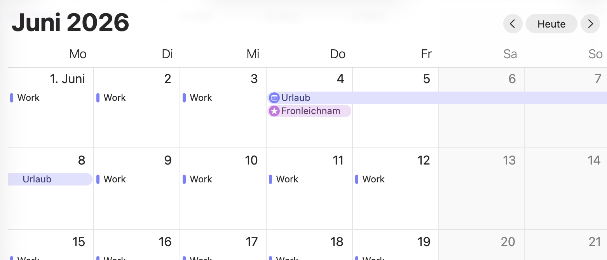
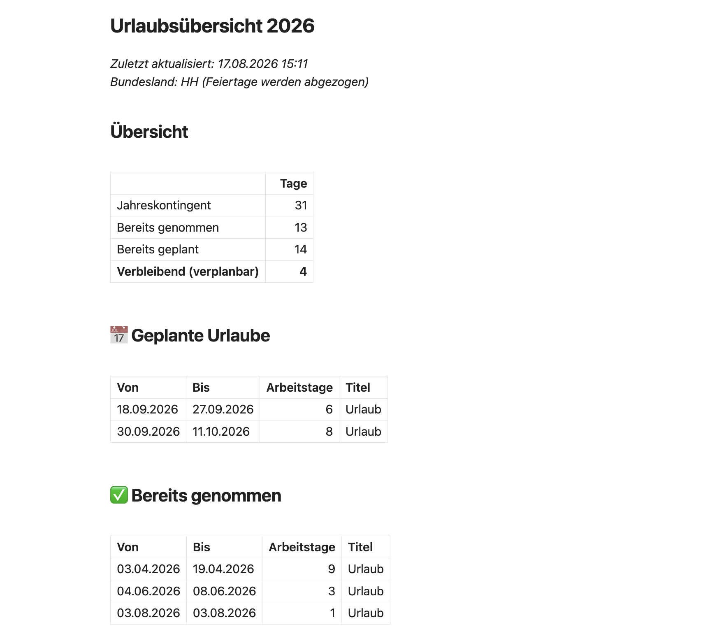

# Urlaubs-Tracker

Liest Urlaubs-Events aus einem iCloud-Kalender und generiert eine Markdown-Übersicht mit Resturlaubs-Berechnung. Berücksichtigt automatisch Wochenenden und gesetzliche Feiertage des gewählten Bundeslandes.




## Features

- Liest Urlaube direkt aus dem iCloud-Kalender (via öffentlichem iCal-Link)
- Zählt nur Arbeitstage (Wochenenden und Feiertage werden abgezogen)
- Automatische Feiertagsberechnung für alle deutschen Bundesländer
- Resturlaubs-Berechnung: `Kontingent + Übertrag - genommen - geplant`
- Automatischer Resturlaub-Übertrag ins nächste Jahr inkl. Verfall-Frist (z.B. 31.03.), Urlaubsanspruch pro Jahr konfigurierbar
- Trennung in *aktuell im Urlaub*, *geplant* und *bereits genommen*
- Zählt zusätzlich **Homeoffice-Tage** und **Krankheitstage** pro Jahr (nur bis heute)
-  Konfiguration via JSON-Datei
- Output als saubere Markdown-Datei (z.B. für Obsidian)

## Voraussetzungen

- Python 3.9+
- iCloud-Kalender mit Urlaubs-Events
- Öffentlicher iCal-Link des Kalenders

## Installation

### 1. Virtuelle Umgebung erstellen (empfohlen)

```bash
python3 -m venv venv
source venv/bin/activate
```

### 2. Dependencies installieren

```bash
pip install icalendar requests holidays
```

## Setup

### iCloud-Kalender freigeben

Am besten einen eigenen Kalender nur für Urlaub anlegen, damit keine privaten Termine über die öffentliche URL einsehbar sind.

**Am iPhone/iPad:**
1. Kalender-App → unten auf *Kalender* tippen
2. Beim gewünschten Kalender auf das ⓘ-Symbol
3. *Öffentlicher Kalender* aktivieren
4. *Link teilen* → Link kopieren

**Am Mac:**
1. Kalender-App öffnen
2. Rechtsklick auf den Kalender → *Kalender freigeben…*
3. Haken bei *Öffentlicher Kalender* setzen
4. Auf das Sende-Symbol klicken → *Link kopieren*

Der Link sieht aus wie `webcal://p156-caldav.icloud.com/published/...`


### URL als Umgebungsvariable setzen

```bash
export URLAUB_ICAL_URL="https://p156-caldav.icloud.com/published/2/..."
```

Damit das nicht jedes Mal manuell geht, kannst du die Zeile in deine `~/.zshrc` (macOS Default) oder `~/.bashrc` packen.

### Konfiguration anpassen

In `urlaub_config.json`:

```json
{
  "urlaubstage_pro_jahr": {
    "2026": 31,
    "2027": 34
  },
  "resturlaub_nehmen_bis": "31.03.",
  "bundesland": "BY",
  "event_titel": "Urlaub",
  "ho_titel": "HO",
  "krank_titel": "krank",
  "jahr": null,
  "output_pfad": "~/Documents/urlaub.md"
}
```

| Feld | Bedeutung |
|---|---|
| `urlaubstage_pro_jahr` | Dein Jahreskontingent pro Jahr. Fehlende Jahre übernehmen den letzten Wert davor. Ab dem ersten eingetragenen Jahr wird Resturlaub automatisch übertragen. Eine einfache Zahl (z.B. `31`) geht auch – dann ohne Übertrag. |
| `resturlaub_nehmen_bis` | Frist (TT.MM.) für den Übertrag aus dem Vorjahr. Urlaub bis zur Frist wird zuerst vom Übertrag abgezogen, der Rest verfällt danach. Vorher gibt es eine Warnung. |
| `bundesland` | Kürzel für Feiertage (siehe unten) |
| `event_titel` | Filter für Kalender-Events (case-insensitive) |
| `ho_titel` | Homeoffice-Filter – muss als **ganzes Wort** im Titel stehen (`Work HO` ✓, `Honey` ✗) |
| `krank_titel` | Krankheits-Filter (case-insensitive, Teilstring, z.B. `Krankheit`) |
| `jahr` | `null` = aktuelles Jahr, sonst z.B. `2026` |
| `output_pfad` | Wohin die `.md`-Datei geschrieben wird |

**Bundesland-Kürzel:**

| Code | Bundesland | Code | Bundesland |
|---|---|---|---|
| BW | Baden-Württemberg | NI | Niedersachsen |
| BY | Bayern | NW | Nordrhein-Westfalen |
| BE | Berlin | RP | Rheinland-Pfalz |
| BB | Brandenburg | SL | Saarland |
| HB | Bremen | SN | Sachsen |
| HH | Hamburg | ST | Sachsen-Anhalt |
| HE | Hessen | SH | Schleswig-Holstein |
| MV | Mecklenburg-Vorpommern | TH | Thüringen |

## Benutzung

```bash
cd ~/urlaub-tracker
source venv/bin/activate
python3 urlaub_tracker.py
```

Erwartete Ausgabe:

```
Config: 31 Tage, Bundesland BY, Jahr 2026
Feiertage geladen: 13
Lade Kalender …
Gefunden: 4 Urlaubs-Event(s)
✓ Geschrieben: /Users/du/Documents/urlaub.md
  Genommen: 5 | Geplant: 8 | Rest: 18
```

Die Markdown-Datei sieht dann etwa so aus:

```markdown
# Urlaubsübersicht 2026

*Zuletzt aktualisiert: 22.05.2026 14:30*
*Bundesland: BY (Feiertage werden abgezogen)*

## Übersicht

| | Tage |
|---|---:|
| Jahreskontingent | 31 |
| Bereits genommen | 5 |
| Bereits geplant | 8 |
| **Verbleibend (verplanbar)** | **18** |

## 📅 Geplante Urlaube
…
```

## Globaler Befehl `urlaub` einrichten

Damit du den Tracker bequem von überall mit `urlaub` aufrufen kannst (statt jedes Mal ins Projektverzeichnis zu wechseln):

### 1. Wrapper-Skript ins Projektverzeichnis legen

Die Datei `urlaub` (Shell-Skript ohne Endung) gehört in dasselbe Verzeichnis wie `urlaub_tracker.py`.

### 2. `.env`-Datei für die iCal-URL anlegen

Im Projektverzeichnis eine `.env`-Datei erstellen:

```bash
echo 'export URLAUB_ICAL_URL="https://p156-caldav.icloud.com/published/2/..."' > .env
```

> ⚠️ **Wichtig:** Das `export` darf nicht fehlen, sonst kommt die Variable nicht bei Python an.

> 💡 **Tipp:** `.env` zu `.gitignore` hinzufügen, falls das Projekt in Git landet.

### 3. Skript ausführbar machen

```bash
chmod +x urlaub
```

### 4. Symlink in den PATH legen

```bash
mkdir -p ~/.local/bin
ln -s "$(pwd)/urlaub" ~/.local/bin/urlaub
```

> 📝 Auf neueren Macs existiert `/usr/local/bin` oft nicht – deshalb `~/.local/bin`.

### 5. PATH prüfen

```bash
echo $PATH | tr ':' '\n' | grep -q "$HOME/.local/bin" && echo "✓ drin" || echo "✗ fehlt"
```

Falls "fehlt", zur Shell-Konfiguration hinzufügen:

```bash
echo 'export PATH="$HOME/.local/bin:$PATH"' >> ~/.zshrc
source ~/.zshrc
```

### 6. Testen

Von einem **beliebigen Verzeichnis** aus:

```bash
urlaub
```

Das Wrapper-Skript:
- findet sich selbst über den Symlink (egal wo das Projekt liegt)
- lädt automatisch die `.env`-Datei aus dem Projektverzeichnis
- nutzt das venv im Projektverzeichnis
- gibt hilfreiche Fehlermeldungen falls etwas fehlt


## Automatisierung

Damit das Skript regelmäßig (z.B. täglich) läuft, kannst du einen Cron-Job einrichten:

```bash
crontab -e
```

Zeile einfügen (täglich um 8 Uhr):

```
0 8 * * * cd ~/urlaub-tracker && URLAUB_ICAL_URL="https://..." ./venv/bin/python urlaub_tracker.py
```

Auf macOS kannst du alternativ `launchd` nutzen (eleganter, aber aufwändiger zu konfigurieren).

## Wie werden Tage gezählt?

- Nur **Werktage (Mo–Fr)** zählen
- **Feiertage** im konfigurierten Bundesland werden abgezogen
- **Urlaube über Jahreswechsel** werden korrekt auf beide Jahre aufgeteilt (z.B. 28.12.–05.01.)
- Termine mit Uhrzeit (z.B. HO 08:30–16:30) zählen als ganzer Tag, mehrere HO-Termine am selben Tag nur einmal
- iCal-`DTEND` ist exklusiv (Standard) – wird beim Anzeigen korrigiert, sodass der letzte tatsächliche Urlaubstag erscheint

## Lizenz

Privates Projekt, mach damit was du willst.
